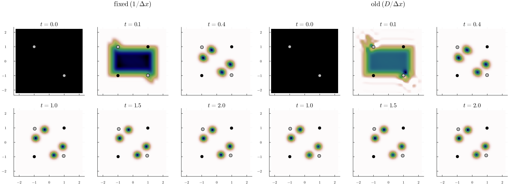
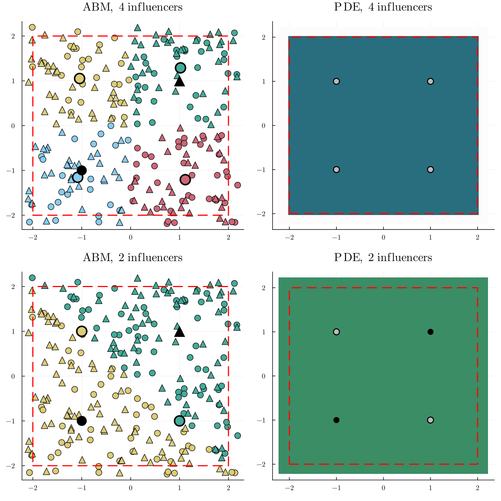
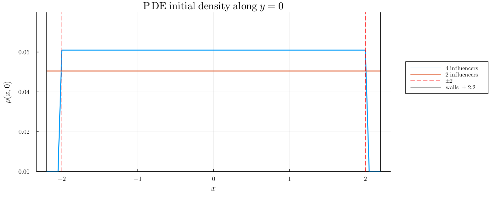

# The boundary-flux bug in the PDE solver

## 1. Continuous problem

For each density $\rho = \rho_{m,l}$ the PDE is

$$
\partial_t \rho = D\,\Delta\rho - \nabla\cdot(\rho F) + (\text{switching}),
\qquad D = \tfrac{\sigma^2}{2},
$$

on $D = [-2.2, 2.2]^2$. The total flux is $J = \rho F - D\nabla\rho$. No-flux means $J\cdot n = 0$ on $\partial D$, i.e.

$$
D\,\partial_n \rho = \rho\, F\cdot n \quad \text{on } \partial D .
$$

This is exactly the condition in the Helfmann et al. (2023) supplementary ("No-flux boundary conditions", $\tfrac12\sigma^2\nabla\rho\cdot n = \rho F\cdot n$). Integrating the PDE and using the divergence theorem, it gives $\frac{d}{dt}\int_D \rho = 0$. Switching only moves mass between the $\rho_{m,l}$, so it cancels in the sum.

## 2. What the code does

The grid has nodes $x_1,\dots,x_N$ with spacing $\Delta x$, and $x_1$ and $x_N$ lie **on** the walls. In one direction (the other is identical), write $v_i = \rho_i F_{x,i}$. `f` in `src/pde.jl` computes

$$
\dot\rho_i = D\,(M\rho)_i - (C v)_i + (\text{boundary term at } i = 1, N).
$$

- `second_derivative` gives $M = \frac{1}{\Delta x^2}\,\mathrm{tridiag}(1,-2,1)$ with $M_{11} = M_{NN} = -\frac{1}{\Delta x^2}$. This is the 3-point Laplacian with a ghost node $\rho_0 = \rho_1$ (and $\rho_{N+1} = \rho_N$), i.e. homogeneous Neumann, $\partial_n\rho = 0$.
- `centered_difference` gives $C$: centred differences $(v_{i+1}-v_{i-1})/(2\Delta x)$ inside, one-sided $(v_2 - v_1)/\Delta x$ and $(v_N - v_{N-1})/\Delta x$ at the walls.
- The "balance fluxes at boundary" lines then correct the Neumann Laplacian towards the real condition $D\partial_n\rho = \rho F\cdot n$.

## 3. What the correction should be

Put the real boundary condition into the ghost node. At the left wall $n = -e_x$, so

$$
D\,\frac{\rho_1 - \rho_0}{\Delta x} = v_1
\;\;\Longrightarrow\;\;
\rho_0 = \rho_1 - \frac{\Delta x}{D}\, v_1 .
$$

The diffusion term at node 1 becomes

$$
D\,\frac{\rho_0 - 2\rho_1 + \rho_2}{\Delta x^2}
= \underbrace{D\,\frac{\rho_2 - \rho_1}{\Delta x^2}}_{D (M\rho)_1}
\;-\; \frac{v_1}{\Delta x}.
$$

At the right wall, $\rho_{N+1} = \rho_N + \frac{\Delta x}{D} v_N$ gives $+\,v_N/\Delta x$. So the correction is

$$
-\frac{1}{\Delta x}\,\rho_1F_{x,1} \quad\text{and}\quad +\frac{1}{\Delta x}\,\rho_NF_{x,N}:
$$

**the $D$ cancels.**

## 4. The bug

The code had

```julia
dif[1,:]   += -D/dx * (rhoforce[1,:,1])
dif[end,:] +=  D/dx * (rhoforce[end,:,1])
dif[:,1]   += -D/dy * (rhoforce[:,1,2])
dif[:,end] +=  D/dy * (rhoforce[:,end,2])
```

It adds $\mp D\,v/\Delta x$ instead of $\mp v/\Delta x$, so there is an extra factor $D = \sigma^2/2 = 0.125$ and the correction is **8 times too small**. Equivalently, the code imposes

$$
\partial_n\rho = \rho F\cdot n \qquad\text{instead of}\qquad D\,\partial_n\rho = \rho F\cdot n,
$$

and the two agree only if $\sigma = \sqrt2$.

**What changed** (26 Nov 2026): the four lines now use `1/dx` and `1/dy`. Nothing else changed.

In `default-ns-2inf`, where the density starts on the walls, the bug is clearly visible at $t = 0.1$ (fixed on the left, old on the right):



## 5. Effect on mass

Sum $\dot\rho_i$ over a grid row. The columns of $M$ sum to zero, so diffusion drops out. The centred sum telescopes:

$$
\sum_i (Cv)_i = \frac{3v_N - v_{N-1} - 3v_1 + v_2}{2\Delta x}.
$$

With a correction $\kappa\,(v_N - v_1)/\Delta x$, where $\kappa = D$ (old) or $\kappa = 1$ (fixed),

$$
\frac{d}{dt}\sum_i \rho_i
= (\kappa - 1)\,\frac{v_N - v_1}{\Delta x}
\;+\; \frac{(v_1 - v_2) + (v_{N-1} - v_N)}{2\Delta x}.
$$

- **Old code** ($\kappa = D$): the first term is $O(1)$ in the mass (after multiplying by $\Delta x\,\Delta y$ and summing rows) and does **not** go to zero as $\Delta x \to 0$, so the boundary condition is inconsistent. At the start the forces point inward, so $v_1 > 0$ and $v_N < 0$; with $D - 1 < 0$ this means mass is **gained**.
- **Fixed code** ($\kappa = 1$): only the second term is left. It is $\approx -\tfrac12(\partial_x v(x_1) + \partial_x v(x_N))$ per row, i.e. a first-order $O(\Delta x)$ error in the mass, coming from the one-sided drift differences at the walls. It is small unless $\rho F$ changes steeply at the walls.

The error only appears where there is density at the walls. Once the density has moved away from them, the mass stays constant.

Measured mass ($\int\rho$, starting at 1, $\Delta x = 0.05$):

| case | old code | fixed code |
|---|---|---|
| `default-ns-2inf` | 1.042 | 0.977 |
| `default` | 1.011 | 1.001 |
| `default-ns` | 1.011 | 1.001 |
| `default-ns-closer` | 1.018 | 1.001 |
| `default-t10` | 1.011 | 1.001 |

These are the values at $t = 2$ ($t = 10$ for `default-t10`, the same as at $t = 2$). In every case all of the change happens before $t \approx 0.05$, and the mass is constant afterwards. The 4-influencer cases start on $[-2,2]^2$, but diffusion and the discontinuous edge of the initial density still reach the walls in the first few time steps. So the old code gains 1–2% there too; with the fix the change is about 0.1%.

## 6. Is it in the papers?

**Helfmann et al. (2023).** The mathematics is right: the supplementary states the correct condition $\tfrac12\sigma^2\nabla\rho\cdot n = \rho F\cdot n$, and the papers don't describe the discretization. The bug is in the code they used:
- The `D/dx` lines are already in the upstream history in August 2022. Commit `d387f7b` (Sikorski, "optimize f (part 2)") only renamed `force.*rho` to `rhoforce`, and the factor $D$ was there before that.
- That is before the paper appeared (November 2023), so its PDE figures were computed with the extra $D$.
- How much this matters depends on how much density reaches the walls. The `4inf` initial density sits on $[-2,2]^2$, away from the walls of $[-2.2,2.2]^2$, but the old code still gains 1.1% mass in `default` (table above), all before $t \approx 0.05$.

**Your paper (`1 paper/main.tex`).**
- The scheme description (line 311: Neumann Laplacian, one-sided drift at the boundary, a correction term to balance fluxes) matches the code; it doesn't state the factor.
- The figures in `1 paper/figures/` were made with the old code.
- Line 417 notes "numerical artefacts close to the boundary at $t=0.1$" in the two-influencer case. Those artefacts come from this bug: they disappear with the fix (see `figures/img-default-ns-2inf_comparison/`).

## 7. A separate issue: the initial conditions don't match

This is not part of the bug, but it decides how much the bug shows.

All simulations live in the same box $D = [-2.2, 2.2]^2$. The question is **where the individuals are at $t = 0$**:

| setup | ABM | PDE |
|---|---|---|
| 4 influencers (`4inf`, `closer`) | uniform on the whole box $[-2.2, 2.2]^2$ | uniform on $[-2, 2]^2$ only; **zero** in the 0.2-wide strip along the walls |
| 2 influencers (`2inf`) | uniform on the whole box | uniform on the whole box |

The red dashed square is $[-2, 2]^2$:



- **Top left, ABM with 4 influencers:** individuals all the way to the walls, including the strip outside the red square.
- **Top right, PDE with 4 influencers:** the coloured area stops at the red square. The strip between it and the walls is empty (white).
- **Bottom row, 2 influencers:** ABM and PDE both fill the whole box.

Along the line $y = 0$, the PDE initial density looks like this:



The 4-influencer density (blue) is a plateau between $-2$ and $2$ and drops to zero before the walls. Since the same total mass sits on a smaller area, the plateau is higher. The 2-influencer density (orange) is flat right up to the walls.

**Where it is in the code:**
- ABM: `ABMinit`, `ABMinit_closer`, `ABMinit_2inf` in `src/abm.jl` sample `x = rand(n,2) .* (domain[1,2]-domain[1,1]) .+ domain[1,1]`, i.e. the whole box.
- PDE, 4 influencers: `uniforminit` in `src/pde.jl` (lines 67–72) fills only the indices from `start_x`, which corresponds to $x = -2$, to `end_x`, i.e. $x = 2$.
- PDE, 2 influencers: `uniforminit_2inf` in `src/pde.jl` fills every grid point.

**Consequences:**
1. **The ABM–PDE comparison isn't like for like** in the 4-influencer cases: the two don't start from the same distribution. This affects e.g. the ensemble figure `figures/img-default/default_pde-ensemble.pdf`; at $t = 0$ the ABM row fills the box and the PDE row has an empty border.
2. **The influencer start positions differ.** In the ABM each influencer starts at the mean of its followers, about $(\pm1.1, \pm1.1)$ for a quadrant of the whole box, and slightly random. In the PDE they start at exactly $(\pm1, \pm1)$, the mean of a quadrant of $[-2,2]^2$.
3. **How much the boundary bug shows:** the 4-influencer PDE starts away from the walls, so little density reaches them (old code +1.1% mass). The 2-influencer PDE starts on the walls (+4.2%, and the artefacts at $t = 0.1$).
4. **Helfmann et al. (2023)** say individuals are distributed "uniformly in the opinion space", but they never give its size: $D$ is only "bounded". The box $[-2.2, 2.2]^2$ comes from the code (`domain` in `src/setting.jl`). So the paper doesn't settle whether the start should be $[-2,2]^2$ or the whole box.

**Options:**
- **Everything on $[-2, 2]^2$** (recommended): change the three ABM inits and `uniforminit_2inf`. Everything then starts off the walls, where both the ABM reflection and the PDE wall scheme matter least, and the influencers start at exactly $(\pm1,\pm1)$ in both models. State the $[-2,2]^2$ explicitly in the paper.
- **Everything on the whole box:** change only `uniforminit`. This leaves the ABM untouched. But all PDE runs then start on the walls, so they carry the remaining $O(\Delta x)$ wall error (about −2% mass, as in `default-ns-2inf` with the fixed code).

Either option means rerunning all figures (and `figures-bug/`).
